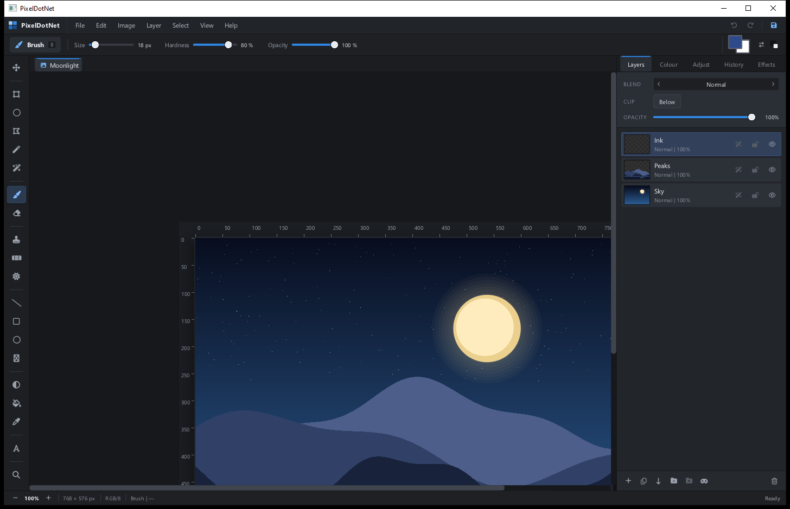
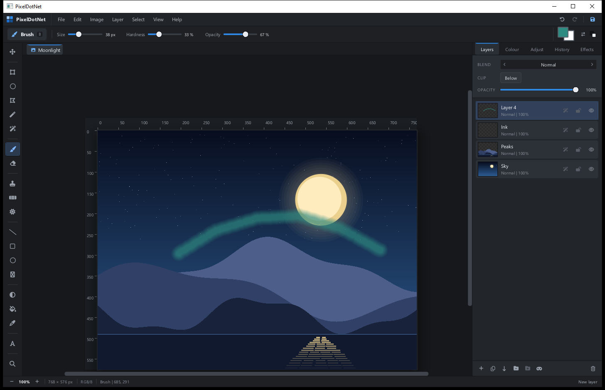
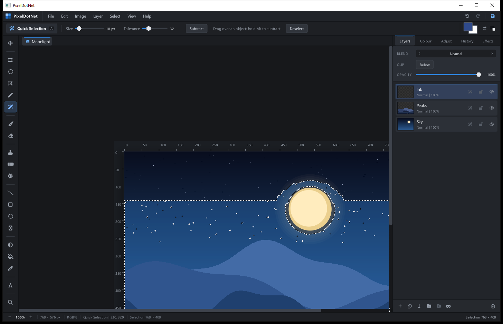
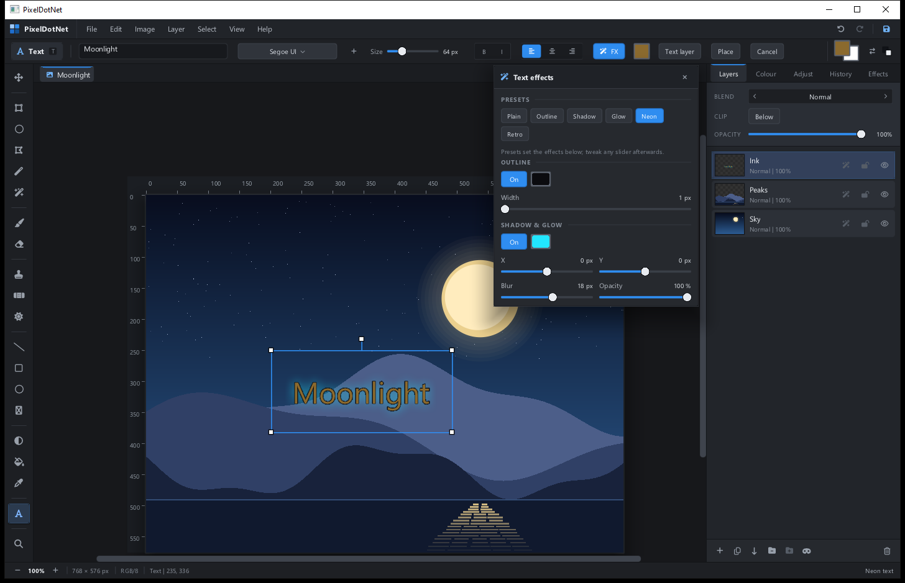

# PixelDotNet

**A free image editor for painting, photo editing, and design.** Open a picture, clean it up, cut something out, add text, and export it — without an account, a subscription, or a cloud upload.

[](https://github.com/OpenCreativeSuite/PixelDotNet/releases/latest)
[](https://opencreativesuite.github.io/PixelDotNet/)



## An editor that gets out of the way

PixelDotNet is a desktop image editor built for the jobs people actually do: retouching a photo, removing a distraction, cutting out a subject, making a thumbnail or poster, or painting something from scratch.

It opens with a sample image so you can try every tool straight away. There is no onboarding tour, no account wall, and no project setup. Pick a tool, use it, undo it, try again.

- **Free to use, and it stays free.** Every tool is included.
- **Private by design.** Your images are opened, edited, and saved on your computer. No telemetry, no ads, no cloud.
- **Real files in and out.** PNG, JPEG, BMP, TGA, SVG, and layered `.pxd` projects.
- **Light enough to keep open.** It starts quickly and stays responsive while you work.
- **Familiar if you have used an image editor before.** Layers, selections, masks, blend modes, and shortcuts work the way you expect.

## What you can do with it

### Paint and draw

A round brush with adjustable size, hardness, and opacity. An eraser, straight lines, rectangles, ellipses, linear gradients, and a paint bucket. Draw editable shapes and Bezier paths that stay sharp, or place live text with outlines, shadows, and glows.

### Edit and retouch photos

Quick Selection and Magic Wand for fast cut-outs. Clone Stamp and Healing Brush for blemishes and distractions. Dodge and Burn for local light. Content-Aware Fill to remove an object. Perspective Transform and Mesh Warp to fix angles and reshape details. Red-eye removal, colour balance, levels, curves, and a full set of live effects.

### Design with layers and type

Layer masks, clipping, groups, opacity, and blend modes. Non-destructive drop shadows, strokes, and outer glows. Smart objects that keep their original pixels. Editable text layers and text that follows a path. Shape and path layers that survive save and reload, and export as real vectors to SVG.

### Finish and share

Save a flattened image for the web, or a layered project you can reopen later. Batch-resize and convert a whole folder at once. Export clean SVG for logos and illustrations, or import SVG artwork as editable layers.

## Made for everyday jobs

| I want to… | PixelDotNet can |
| --- | --- |
| Remove a person or object from a photo | Select it, then use **Edit → Content-Aware Fill** |
| Clean up a blemish or dust spot | **Healing Brush** or **Clone Stamp** |
| Cut a subject out of its background | **Quick Selection**, copy it to a new layer, then refine with a **layer mask** |
| Add a title or caption | **Text tool** with fill, outline, shadow, and glow |
| Make text curve around a badge | **Pen** path + **Layer → Text on Path…** |
| Make a black-and-white or duotone image | **Image → Desaturate** or **Gradient Map** |
| Fix a tilted building or poster | **Edit → Perspective Transform** |
| Resize 200 images for a website | **File → Batch Process** |
| Keep a design editable for later | **File → Save Project** (`.pxd`) |
| Use a logo in a design | **File → Import SVG**, then edit it as layers |

## Get started in a minute

1. **Download the build for your computer.** Windows, Linux, and Apple Silicon or Intel macOS builds are attached to the [latest release](https://github.com/OpenCreativeSuite/PixelDotNet/releases/latest). Unzip it and run `PixelDotNet` (`PixelDotNet.exe` on Windows). There is no installer.
2. **Try the sample.** PixelDotNet opens with the layered *Moonlight* image. Paint on a new layer, drag a selection, or open the **Adjust** tab and move a slider.
3. **Open your own picture.** Choose **File → Open…** or press <kbd>Ctrl</kbd>+<kbd>O</kbd>.
4. **Save when you are happy.** <kbd>Ctrl</kbd>+<kbd>S</kbd> saves a PNG, JPEG, BMP, or TGA. Use **File → Save Project…** if you want to keep your layers.

If you close the app after saving only a PNG, the layers are gone — the picture itself is saved. Save a `.pxd` project as well whenever you might want to edit the design again.

## A look around

| Paint and draw | Cut out and retouch | Add text and effects |
| --- | --- | --- |
|  |  |  |

## Free and private

PixelDotNet is free to use and will stay free. There is no paid tier, no subscription, no account, no advertising, and no telemetry. The program does not record what you do and does not send usage data anywhere.

Your images are opened and saved on your own computer. The only optional online action is adding a font from [cdnfonts](https://www.cdnfonts.com/) when you choose to use **Add Font** in the Text tool. Nothing is uploaded.

## Licence

PixelDotNet is free for personal and commercial use, including internal business use. The source is available under the **Apache License 2.0 with the Commons Clause**: you can use, modify and share it, but you may not sell the software itself or a product whose value derives substantially from it. The images you make are yours.

See [LICENSE.md](LICENSE.md) for the full terms and a plain-English summary.

## Learn the app

The illustrated user guide is the friendliest place to start:

**https://opencreativesuite.github.io/PixelDotNet/**

- [Recipes](https://opencreativesuite.github.io/PixelDotNet/recipes.html) — short step-by-step jobs, from removing an object to making text follow a curve
- [Painting](https://opencreativesuite.github.io/PixelDotNet/tools.html) — brushes, shapes, fills, paths, and text
- [Cutting out](https://opencreativesuite.github.io/PixelDotNet/selections.html) — selections and masks
- [Layers & text](https://opencreativesuite.github.io/PixelDotNet/layers.html) — the layer stack, styles, smart objects, and vector artwork
- [Colour & effects](https://opencreativesuite.github.io/PixelDotNet/adjustments.html) — tone, colour, filters, and transforms
- [Save & share](https://opencreativesuite.github.io/PixelDotNet/files.html) — formats, projects, SVG, and batch processing
- [Shortcuts](https://opencreativesuite.github.io/PixelDotNet/shortcuts.html) — every key in one place

The guide source lives in [`docs/`](docs/index.html) and can be opened directly from a local checkout.

## Run from source

You need the [.NET 10 SDK](https://dotnet.microsoft.com/download).

```sh
dotnet run
```

Or start the built `PixelDotNet.exe` from `bin/`.

Run the unit tests with:

```sh
dotnet test tests/PixelDotNet.Tests/PixelDotNet.Tests.csproj
```

The suite covers the paint engine, document/file formats, the editor session,
and every component through the headless `Donkeh.Testing` harness.

## Project links

- [Latest release](https://github.com/OpenCreativeSuite/PixelDotNet/releases/latest)
- [User guide](https://opencreativesuite.github.io/PixelDotNet/)
- [Documentation source](docs/)
- [Website workflow](.github/workflows/pages.yml) and [release workflow](.github/workflows/release.yml)
